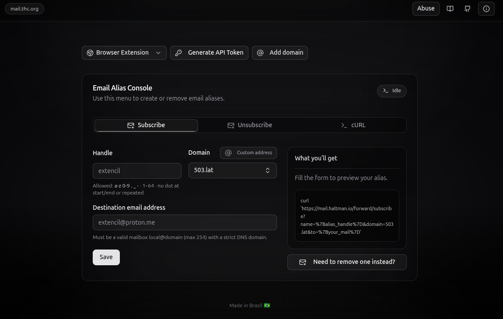
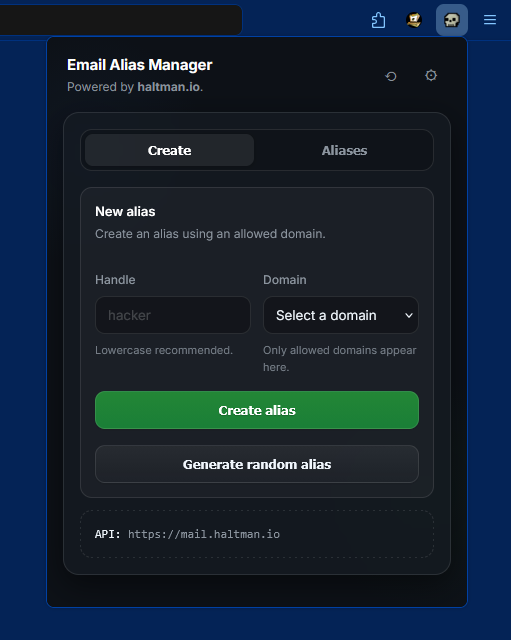
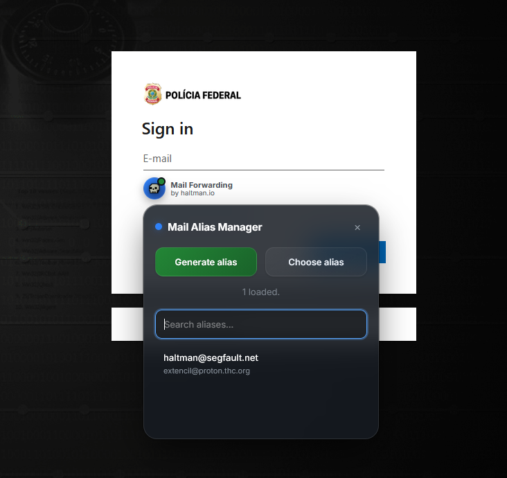
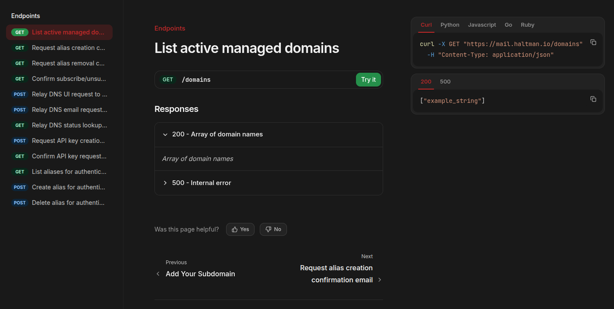

<div align="center">

<!-- Runtime / Status -->
<a href="https://forward.haltman.io/"></a>&nbsp;&nbsp;<a href="https://t.me/haltman_group"></a>


</div>

---

This repository is an overview and aggregator for **Haltman.io's Mail Forwarding** — a free, open-source email forwarding stack built and maintained by [Haltman.io](https://haltman.io) and [The Hacker's Choice](https://www.thc.org). The source code for each component lives in its own repository, linked below.

---

## What is this?

Your real email address is the master key. It ties your bank, your medical records, your forum accounts, and your streaming subscriptions into one single, correlatable identity. In 2025, over 16 billion credentials were compiled from infostealer malware and prior breaches. Your inbox isn't private — it's a liability sitting in a hundred databases you've never heard of.

Email alias services exist to fix this. You get an address like `something@somedomain.net`, it forwards to your real inbox, and the service you signed up for never sees who you are. If it leaks, you kill the alias. Done.

SimpleLogin, addy.io, Firefox Relay — they all do this. They work. But we didn't want a product. We wanted **infrastructure**. Our own. Under our control. With no limits, no pricing tiers, and the ability to burn everything to the ground whenever we felt like it.

So we built one.

---

## How to use it

**Web UI**: Go to [mail.thc.org](https://mail.thc.org). Pick a handle, pick a domain (50 available), enter your real email. Confirm the 6-digit token. Done. No account. No payment. No login.

**Terminal**:
```bash
curl 'https://mail.haltman.io/api/forward/subscribe?name=myhandle&domain=segfault.net&to=you@proton.me'
# check your inbox, grab the 6-digit token
curl 'https://mail.haltman.io/api/forward/confirm?token=123456'
```

**API key**: Request one via the UI or API. Confirmed by email, shown once, stored as a hash. Use it in `X-API-KEY` for programmatic management.

**Firefox add-on**: [Available on AMO](https://addons.mozilla.org/en-US/firefox/addon/email-alias-manager/). Stores your API key locally (AES-GCM encrypted, PBKDF2 key derivation). Communicates only with the API. No browsing history, no analytics, no telemetry.

---

## Screenshots

#### Web UI
> [mail.thc.org](https://mail.thc.org/)



#### Browser Extension (Mozilla Firefox)
> [Email Alias Manager on AMO](https://addons.mozilla.org/en-US/firefox/addon/email-alias-manager/)





#### API Documentation
> [dev.haltman.io/api-reference](https://dev.haltman.io/api-reference/get-domains)



---

## Available domains

The service offers 50 domains, several with roots in the security and hacker community.

| - | - | - | - |
| ---------------- | ---------------- | ----------------- | --------------------- |
| 503.lat          | abin.lat         | pwnd.lat          | revil.org             |
| lockbit.io       | polkit.org       | haltman.org       | segfault.net          |
| unhandle.org     | homoglyph.org    | mishandle.org     | metasploit.io         |
| 1337.meu.bingo   | smokes.thc.org   | kerberoast.org    | thc.extencil.me       |
| mvttrb.com       | stealth.rest     | fwd.haltman.io    | halt.ciphine.com      |
| reads.phrack.org | cobaltstrike.org | johntheripper.org | the.hackerschoice.org |
| alias-for-lammers.howosec.com | | | |

Some notable domains:

- `reads.phrack.org` — Phrack, the original hacking e-zine
- `smokes.thc.org` — The Hacker's Choice, since 1995
- `free.team-teso.net` — Team TESO, early-2000s exploit research
- `segfault.net` — general-purpose, disposable
- `ghetto.eurocompton.net` — oldest IDS enemy
- `lulz.antisec.net` — you know what it is

> **Note:** Some domains like `metasploit.io`, `polkit.org`, `cobaltstrike.org`, and `johntheripper.org` were found available for public registration and integrated into the pool. They are not affiliated with the original projects. The UI shows a clear disclaimer — non-profit, open-source, community use.

---

## Architecture

The stack has three layers. No application code touches email — Postfix moves mail, Dovecot authenticates senders, the API manages rules. Separation of concerns, the way it should be.

### 1. Core (Postfix + Dovecot + PostSRSd + MariaDB + OpenDKIM)

This is the mail transport layer.

- **Postfix** resolves recipients through two lookup layers — first handle-based (`alias_handle`), then address-based (`alias`) — with recipient allowlisting, domain verification (`domain`), and sender ACL enforcement (`smtp_sender_acl`) all backed by 8 MySQL map files. Inbound SRS addresses from external sources are explicitly rejected.
- **Dovecot** provides SASL authentication for the submission path (port 587, localhost only). Credentials are verified against `smtp_users` via TCP on `127.0.0.1:12345`. Postfix enforces a deny-by-default sender policy: if your login isn't mapped to that MAIL FROM address in `smtp_sender_acl`, the message is rejected.
- **PostSRSd** rewrites envelope senders on forwarded mail. Without SRS, forwarded email fails SPF/DMARC checks at the destination and ends up in spam or gets rejected outright.
- **MariaDB** stores alias mappings, domain registry, sender ACLs, SMTP credentials, API tokens, user accounts, and DNS verification state — 15 tables total. Postfix queries 4 of them directly; the rest are managed by the API.
- **OpenDKIM** signs outbound messages via milter. Optional, but critical for deliverability.

### 2. API (Node.js + NestJS + Redis)

This is where the security lives. The API manages the lifecycle of aliases through a confirmation-based flow. Redis handles rate limiting state and session caching.

- **Confirmation tokens**: 6 digits via CSPRNG, stored as SHA-256 hashes (never plaintext), 10-minute TTL, 60-second cooldown between resends
- **Anti-loop**: destination can't be an existing alias, can't use a managed domain, can't be itself
- **RFC validation**: local-part against RFC 5322, domain against RFC 1035
- **Rate limiting**: ~856 lines of middleware — hard limits plus cumulative slow-down (250ms escalating per request to tire out automated tools)
- **Ban system**: multi-layer by IP (IPv4/IPv6 normalization), domain (recursive subdomain matching), email, and name
- **Transparency**: the confirmation page shows the token, the alias, the destination, and the exact SQL mutation that will be applied — `INSERT` or `DELETE` — before you hit confirm

### 3. UI (Next.js + React + Tailwind CSS)

A front door to the API. Domain selection with hacker-culture badges, `curl` command generation for every action, API key management. No account required for basic use.

---

## Security

- **Admin auth**: Argon2id, 128 MB memory cost (anti-GPU/ASIC). No self-registration. Login rate-limited on failures only. Non-existent emails trigger a dummy hash to prevent timing-based enumeration
- **JWT**: EdDSA (Ed25519) with key rotation via `kid`. Max 5 sessions per admin. Sign-out-all available. Every login and account change sends an email notification
- **CSRF**: HMAC-SHA256 with `crypto.timingSafeEqual`
- **Cookies**: `__Host-` prefix, `httpOnly`, `Secure` in production
- **API keys**: 256-bit, stored as SHA-256 hashes, shown once
- **HTTP hardening**: `no-store`, `no-referrer`, `X-Powered-By` disabled, Helmet, strict CORS whitelist, 32 KB body limit, `x-request-id` on every request, `whitelist: true` on ValidationPipe
- **Logging**: 12 categories of sensitive fields redacted automatically
- **Database**: atomic transactions with `SELECT ... FOR UPDATE`, IPs in `VARBINARY(16)`

We didn't add this list to look impressive. We added it because if you're going to trust a service with your email routing, you should know exactly what's running. Read the code. It's all there.

---

## Limitations

- **No reply-from-alias.** You can receive through the alias, but if you hit "Reply," your real address is exposed. This is forwarding, not a bidirectional alias manager.
- **No message storage.** There's no inbox. If your destination is offline, the mail bounces.
- **No PGP.** We don't add encryption. What arrives is what was sent.
- **No mobile app** (for the service itself — the custom .apk for the "burn everything" scenario is a different story).
- **SRS isn't perfect.** Some strict DMARC `p=reject` policies from original senders can still cause issues. This is a fundamental email forwarding limitation, not ours.
- **Shared domain reputation.** 50 domains, shared pool. If someone abuses a domain, it can affect deliverability for others. We actively ban abusers, but it's a real tradeoff.
- **Beta.** It works. It's tested. There are integration tests for the critical flows. But it's a community project, not a service with SLAs.

### How this compares to SimpleLogin and addy.io

It doesn't compete with them. Different layer.

SimpleLogin (Proton) gives you reply-from-alias, PGP, mobile apps, browser extensions, and integration with the Proton ecosystem. addy.io does the same class of things. They're products. They're good products.

We're infrastructure. No account. No payment. No ecosystem. You get the full core stack, the API, anti-abuse controls, source transparency, and the Unlicense. If you need more than forwarding, use them. If you need a minimal, auditable, self-hostable forwarding layer with no limits and no vendor, use this.

---

## Why we built this


### We didn't want to reinvent the wheel

We didn't create an email server. Postfix has been doing this job since before most "innovative email solutions" existed. We just use it. It reads alias-to-destination mappings from MariaDB and forwards mail. Dovecot handles SASL authentication. PostSRSd rewrites envelope senders. OpenDKIM signs outbound messages. The NestJS API doesn't touch a single email — it just manages the routing rules in the database.

No magic. No proprietary relay. No "nebulous SaaS" that processes your messages through seventeen microservices.

### We didn't want "Ultra-Blaster Innovative Powered by AI" features

We want to receive emails from different domains and forward them to our personal addresses. That's it.

You pick a handle, a domain, a destination. You confirm via email. Postfix starts forwarding. You want to remove it? Same flow: request, confirm, gone.

### We wanted to escape the open-core trap

We want:

- Unlimited forwarding rules
- Unlimited users
- Unlimited addresses
- Unlimited domains
- Unlimited emails
- A picture of Ronaldinho Gaucho on the login menu if we feel like it

We don't want to stop our instance because it hit some "open-core" limit. We don't want to discover that the feature we need is behind a paywall after we've already deployed. The Unlicense means you take the code, you run it, you modify it, you sell it if you want. We don't care. It's yours.

### We wanted real self-hosting

Run it on your own infrastructure. Under your own brand. On your own domains. Host the UI on Vercel, Cloudflare Pages, GitHub Pages, Ngrok, a temporary server on segfault.net, a hidden service on `.onion` — we've done all of these. We even set up Caddy with on-demand TLS because we couldn't stand asking our friends anymore to create DNS records for us. We kicked them out and hosted it ourselves.

### We wanted to learn

Every time we tried something different, we learned something new. We connected the API to Telegram bots and Discord bots. We built browser extensions for Firefox and Chrome. We call the API from the terminal because why not.

This project allowed us to mature internally, meet people who knew things we didn't, and absorb knowledge we'll carry for life. The point is we built it with our own hands and we understand every line.

### We wanted the ability to burn everything

This is the part most people don't think about.

We want to destroy everything whenever, wherever, and when we want. Through a Telegram bot that shuts down the server (LVM with LUKS). Through a custom mobile app. By voice command. By whatever trigger we decide is appropriate.

We don't want to open a ticket on Zendesk. We don't want to send an email to `support@some-company.com` and wait 5 business days for someone to confirm that our data has been "scheduled for deletion." We want complete certainty that everything can be shut down, destroyed, and recreated elsewhere.

Intellectual freedom to think, plan, and try. Without paying a subscription for the privilege.

---

## Backstory

[Lou-Cipher](https://github.com/lou-cipher), from The Hacker's Choice (THC), created a Perl API years ago that allowed alias creation for the THC community. It worked. Then Lou-Cipher went silent, the service went down, and THC put out a notice asking someone to take over.

We're Haltman.io — a crew of Brazilian hackers. Not a company. Not a startup. Not a consultancy. Just friends who've been working together for years, bound by shared principles: freedom, transparency, free software, and the open sharing of knowledge.

We took the concept that already worked, didn't try to reinvent anything, and rebuilt it from the ground up. The core mail stack — Postfix, Dovecot, PostSRSd, MariaDB, OpenDKIM — handles all mail transport, authentication, and signing. On top of that sits a NestJS API with Redis for rate limiting and session state, and a Next.js UI built with React and Tailwind CSS. We wrote proper anti-abuse controls, hardened the authentication, added authenticated SMTP submission with sender ACL enforcement, documented everything, and released it all under the Unlicense — public domain, no restrictions, no copyleft, no strings.

The goal from day one: **low cost, easy maintenance, SECURE, fast migration, and the ability to destroy the whole damn thing whenever we wanted with total guarantee that no data will survive.**

---

## Self-hosting

You need a server with a clean IP (check blacklists first) and DNS control for each domain. The stack is modular — every component has its own repository.

### Core

| Component | Purpose | Repository |
|---|---|---|
| Postfix, Dovecot, PostSRSd, MariaDB, OpenDKIM | MTA, SASL auth, SRS, database, DKIM signing | [mail-forwarding-core](https://github.com/haltman-io/mail-forwarding-core) |

Reference configs for all core components, per-component READMEs, and the full 15-table database schema.

### API

| Component | Purpose | Repository |
|---|---|---|
| NestJS API | Alias lifecycle, auth, rate limiting, bans | [mail-forwarding-api](https://github.com/haltman-io/mail-forwarding-api) |

### UI

| Component | Purpose | Repository |
|---|---|---|
| Next.js UI | Web interface, domain selection, API key management | [mail-forwarding-ui](https://github.com/haltman-io/mail-forwarding-ui) |

### Supporting services

| Component | Purpose | Repository |
|---|---|---|
| DNS checker | Domain DNS verification daemon | [mail-forwarding-dns-checker](https://github.com/haltman-io/mail-forwarding-dns-checker) |
| DKIM sync | Keeps OpenDKIM KeyTable/SigningTable aligned with MariaDB `domain` table | [mail-forwarding-dkim-sync](https://github.com/haltman-io/mail-forwarding-dkim-sync) |
| UI SaaS layer | Caddy + ASK endpoint for on-demand TLS multi-tenant hosting | [mail-forwarding-ui-saas](https://github.com/haltman-io/mail-forwarding-ui-saas) |

### Browser extension

| Platform | Link |
|---|---|
| Firefox (AMO) | [Email Alias Manager](https://addons.mozilla.org/en-US/firefox/addon/email-alias-manager/) |
| Source code | [mail-forwarding-addon-mozilla-firefox](https://github.com/haltman-io/mail-forwarding-addon-mozilla-firefox) |

The DKIM sync tool exists because manually updating KeyTable and SigningTable for 50 domains is the kind of thing you do once before deciding to automate it forever.

---

## About us

**Haltman.io** is an independent collective of Brazilian hackers. Not a company. Not funded. Not a consultancy. We came together through years of friendship and shared technical work. Our members have been part of other groups before, but we chose to move forward independently when those spaces stopped reflecting the values we care about: freedom, transparency, free software, and knowledge sharing.

**The Hacker's Choice** is an international hacker collective founded in 1995. They've released Hydra, AFLplusplus, Segfault.net, and decades of security research. They're not for hire. Everything they do is public. Three members have been arrested (zero convicted), one got raided, two received visits from Germany's federal agencies, and one was blackmailed by GCHQ. The same agencies use their tools.

This project lives under both flags.

---

## Abuse

Despite the tone, we take this seriously.

We do not tolerate abuse of our tools or services. This is no place for ransomware, botnets, DDoS, fraud, revenge-hacking, or criminal activity. We have no patience for this.

The service is for research, education, and legitimate privacy use. If you see abuse, contact us: [root@haltman.io](mailto:root@haltman.io) or [members@proton.thc.org](mailto:members@proton.thc.org). We will stop it.

Report abuse: [mail.thc.org/abuse](https://mail.thc.org/abuse)

---

## Links

- **Live service**: [mail.thc.org](https://mail.thc.org) / [forward.haltman.io](https://forward.haltman.io)
- **API**: [github.com/haltman-io/mail-forwarding-api](https://github.com/haltman-io/mail-forwarding-api)
- **Core stack**: [github.com/haltman-io/mail-forwarding-core](https://github.com/haltman-io/mail-forwarding-core)
- **UI**: [github.com/haltman-io/mail-forwarding-ui](https://github.com/haltman-io/mail-forwarding-ui)
- **UI SaaS**: [github.com/haltman-io/mail-forwarding-ui-saas](https://github.com/haltman-io/mail-forwarding-ui-saas)
- **DNS checker**: [github.com/haltman-io/mail-forwarding-dns-checker](https://github.com/haltman-io/mail-forwarding-dns-checker)
- **DKIM sync**: [github.com/haltman-io/mail-forwarding-dkim-sync](https://github.com/haltman-io/mail-forwarding-dkim-sync)
- **Firefox add-on**: [addons.mozilla.org](https://addons.mozilla.org/en-US/firefox/addon/email-alias-manager/) / [source](https://github.com/haltman-io/mail-forwarding-addon-mozilla-firefox)
- **Haltman.io**: [haltman.io](https://haltman.io)
- **The Hacker's Choice**: [thc.org](https://www.thc.org)
- **Security / VDP**: [mail.thc.org/security](https://mail.thc.org/security)
- **Abuse**: [mail.thc.org/abuse](https://mail.thc.org/abuse)

---

## License

Licensed under [The Unlicense](https://unlicense.org/) — public domain, no restrictions, no copyleft, no strings. You take the code, you run it, you modify it, you sell it if you want. We don't care. It's yours.

```
This is free and unencumbered software released into the public domain.

Anyone is free to copy, modify, publish, use, compile, sell, or
distribute this software, either in source code form or as a compiled
binary, for any purpose, commercial or non-commercial, and by any
means.

In jurisdictions that recognize copyright laws, the author or authors
of this software dedicate any and all copyright interest in the
software to the public domain. We make this dedication for the benefit
of the public at large and to the detriment of our heirs and
successors. We intend this dedication to be an overt act of
relinquishment in perpetuity of all present and future rights to this
software under copyright law.

THE SOFTWARE IS PROVIDED "AS IS", WITHOUT WARRANTY OF ANY KIND,
EXPRESS OR IMPLIED, INCLUDING BUT NOT LIMITED TO THE WARRANTIES OF
MERCHANTABILITY, FITNESS FOR A PARTICULAR PURPOSE AND NONINFRINGEMENT.
IN NO EVENT SHALL THE AUTHORS BE LIABLE FOR ANY CLAIM, DAMAGES OR
OTHER LIABILITY, WHETHER IN AN ACTION OF CONTRACT, TORT OR OTHERWISE,
ARISING FROM, OUT OF OR IN CONNECTION WITH THE SOFTWARE OR THE USE OR
OTHER DEALINGS IN THE SOFTWARE.

For more information, please refer to <https://unlicense.org/>
```

---

## Read the code. Use it or don't. Fork it if you want.

We're not here to sell you anything. There's no pitch, no upsell, no "premium tier coming soon." The code is public. The license is Unlicense. You can run your own instance tomorrow and never talk to us again.

If you find a bug, open an issue. If you find a vulnerability, report it — there's a [VDP and a Hall of Fame](https://mail.thc.org/security). If you have a cool domain you want to add to the pool, reach out. If you just want a disposable alias without creating an account anywhere, go to [mail.thc.org](https://mail.thc.org) and get one in 30 seconds.

We built this because we needed it. We released it because someone else might need it too.

No corporate bullshit. No VC money. No data harvesting. Just aliases.

*Made in Brazil.*
